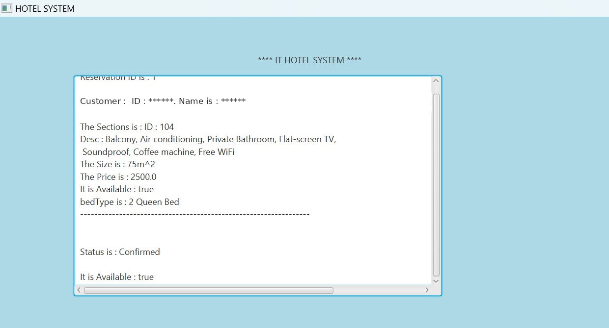
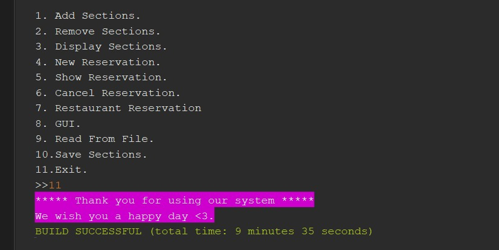
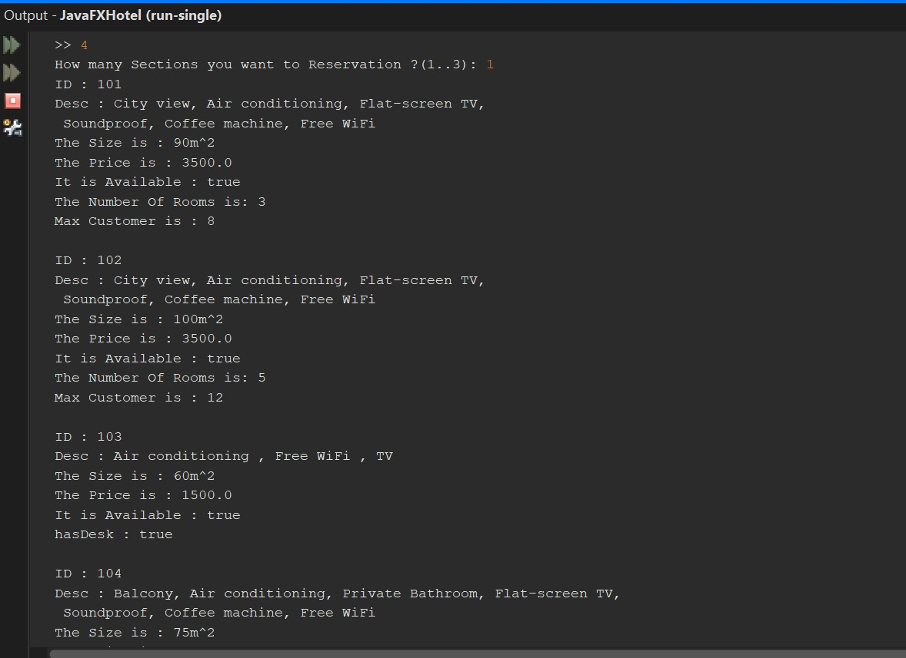

# IT Hotel Management System 🏨

A **Java** hotel management system for managing rooms and suites, booking reservations, ordering from the hotel restaurant, and saving data to files. It runs from a console menu and includes a **JavaFX** window for viewing reservation details.

CS 111 – Programming Languages 2 · Princess Nourah bint Abdulrahman University

<p align="center">
  
</p>

---

## Features
| # | Feature | Description |
|---|---|---|
| 1 | **Add / remove sections** | Add a Suite, Single Room, or Deluxe Room, or remove one by its ID |
| 2 | **Display sections** | List every section with its price, service type, and amenities |
| 3 | **New reservation** | Book up to 3 sections for a customer on a chosen date, with 15% tax included |
| 4 | **Show / cancel reservations** | View reservation details or cancel a reservation by its ID |
| 5 | **Restaurant reservation** | Order from the hotel restaurant (Italian, Indian, French), with the total calculated |
| 6 | **GUI** | JavaFX window that displays the current reservation |
| 7 | **File handling** | Save sections to a text file and read them back |
| 8 | **Error handling** | Catches invalid input, null references, bad casts, and out-of-range indexes so the program doesn't crash |

## Object-Oriented Design
```
             «interface» Reservationable
            (TAX = 15%, MAX_RESERVATION = 3)
                 ▲                    ▲
                 │                    │
            Reservation         HotelRestaurant
        ┌────────┼─────────┐
    Customer   Date   Sections[ ]          ← composition
                          ▲
                «abstract» Sections
          ┌───────────────┼───────────────┐
        Suite        SingleRoom       DeluxeRoom      ← inheritance
```

**OOP concepts applied:** interfaces · inheritance · abstract classes · polymorphism (overridden `showAmenities()` and `serviceType()`) · composition · arrays and `ArrayList` · exception handling · file I/O · JavaFX GUI

## Project Structure
```
src/JavaProjekt/
├── HotelMain.java        # Entry point: menu, program flow, JavaFX GUI
├── Reservationable.java  # Interface with constants and the reservation contract
├── Reservation.java      # Reservation logic, totals, and cancellation
├── HotelRestaurant.java  # Restaurant orders
├── Sections.java         # Abstract base class for all room types
├── Suite.java
├── SingleRoom.java
├── DeluxeRoom.java
├── Customer.java
├── Date.java
├── ReadText.java         # Reads sections from a file
└── WriteText.java        # Writes sections to a file
```

## Screenshots
<p align="center">
  
  
</p>

## How to Run
**Requirements:** JDK 11 or later and the [JavaFX SDK](https://openjfx.io/)

```bash
cd src
javac --module-path /path/to/javafx-sdk/lib --add-modules javafx.controls -d ../out JavaProjekt/*.java
cd ..
java  --module-path /path/to/javafx-sdk/lib --add-modules javafx.controls -cp out JavaProjekt.HotelMain
```
Or open the project in **NetBeans** or **IntelliJ** with JavaFX configured, and run `HotelMain`.

## My Role
I wrote most of the project's code, including:
- **`HotelMain`**: the main program logic, menu flow, and exception handling
- **The JavaFX GUI**
- **`SingleRoom`**: a subclass of `Sections`
- **Composition** in the `Sections` class

## Team
Renad Alduayji · Reuof Jubran · Wejdan Alenazi · Noura Alzahim · Lujain Alahmari
